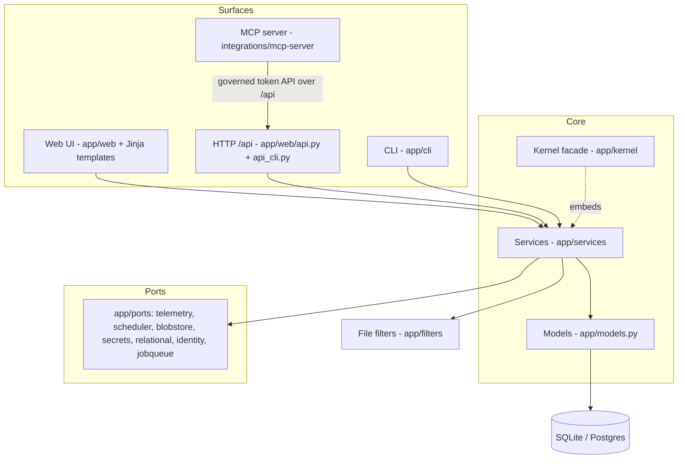

# Localization OS - Architecture Map (L0)

**This is the map.** It describes what Localization OS *is* and how its parts fit, in one read, and
points at the deeper docs for each part. It is **current-state** (what IS, not why or how-we-got-
here); the *why* lives in the ADRs ([`docs/decisions/`](docs/decisions/INDEX.md)) and
the *how-to-operate* lives in [`docs/`](docs/). Every architectural claim here is **pinned to
code** - a `<path>`, a `<path>::<symbol>`, a `setting:<key>`, or a `verify_<suite>` - and a CI guard
([`tests/verify_docs_architecture.py`](tests/verify_docs_architecture.py)) proves the pins still
resolve. Pins never use line numbers; those rot.

> **Layered depth.** Root map (this file) → subsystem doc (`docs/architecture/<subsystem>.md`,
> 38 of them, listed in section 8) → module docstring → the code and its verify suites.
> Each layer says where the next one is. Machine readers start at [`llms.txt`](llms.txt).

---

## 1. What it is

Localization OS is a **local-first, MT-first Translation Management System**: upload content, translate
it automatically through configurable multi-agent LLM workflows with translation-memory and
glossary leverage, post-edit only the exception slice in a built-in CAT editor, run LQA, and
export in the original format - or wire it into a CMS/PIM/help-center through the connectors.

It is a **modular monolith**: one Python process, one relational core (SQLite via SQLModel;
optional Postgres), four *surfaces* over the same services, and a set of **named ports** at the
infrastructure edge. It runs fully offline on a deterministic mock engine with no keys; add a
provider key to `.env` and it goes live with no code change. The same code path scales from a
laptop to an opt-in multi-tenant SaaS behind Postgres and a TLS proxy.

Product framing and the anti-references live in [`PRODUCT.md`](PRODUCT.md); the visual design
system (colors, typography, components - a *different layer* from this software map) lives in
[`DESIGN.md`](DESIGN.md).

## 2. System shape

The app object is assembled in [`app/main.py`](app/main.py) - middleware, error handlers, and the
router composition only; every HTTP route lives in an `APIRouter` module under
[`app/web/`](app/web/). Business logic lives in [`app/services/`](app/services/); the surfaces are
thin callers. Data models are in [`app/models.py`](app/models.py); configuration in
[`app/config.py`](app/config.py); the database engine and boot migration in [`app/db.py`](app/db.py).

## 3. The surfaces + parity law

One feature, up to **four product surfaces** over the **same service seam**:

| Surface | Where | Notes |
|---|---|---|
| Web UI | [`app/web/`](app/web/) | FastAPI + Jinja2 + vanilla JavaScript + Server-Sent Events |
| HTTP `/api` | [`app/web/api.py`](app/web/api.py), [`app/web/api_cli.py`](app/web/api_cli.py) | keyed token API; RBAC mirrors the web predicate |
| CLI / headless | [`app/cli/`](app/cli/) | argparse tree; same services, no server |
| MCP | [`integrations/mcp-server/`](integrations/mcp-server/) | the fourth surface; the app imports no MCP code |

**Parity law:** every user-facing feature ships in *both* the web UI and the CLI in the same
change, with logic in a service seam both call; `/api` and MCP mirror it where they exist. The
guards that hold the line: [`verify_cli_parity`](tests/verify_cli_parity.py) (a CLI leaf with no
capability entry fails), [`verify_mcp_parity`](tests/verify_mcp_parity.py) (an `/api` route with
no MCP accounting fails), and [`verify_help`](tests/verify_help.py) (a route missing from the API
reference fails).

## 4. Kernel + ports (the composable core)

**Kernel facade - [`app/kernel/`](app/kernel/).** A package of *alias shims*: importing
`app.kernel` installs one lazy `sys.meta_path` finder mapping `app.kernel.<name>` onto the real
module it re-exports, so `app.kernel.tm` **is** `app.services.tm` - the facade never
re-implements anything. It gives embedders one import door. The narrow "just the engine" surface
is a real submodule, [`app/kernel/pipeline.py`](app/kernel/pipeline.py) (segment → TM → MT →
stitch → export), whose narrowness bound is proven by
[`verify_kernel_facade`](tests/verify_kernel_facade.py).

**Named ports - [`app/ports/`](app/ports/).** The infrastructure edge is a small set of Protocol
ports, each with a proven default implementation and a port-conformance suite:

| Port | File | Conformance suite |
|---|---|---|
| Telemetry sink | [`app/ports/telemetry.py`](app/ports/telemetry.py) | [`verify_telemetry_sink`](tests/verify_telemetry_sink.py) |
| Scheduler | [`app/ports/scheduler.py`](app/ports/scheduler.py) | [`verify_scheduler_port`](tests/verify_scheduler_port.py) |
| Blob store | [`app/ports/blobstore.py`](app/ports/blobstore.py) | [`verify_blobstore_port`](tests/verify_blobstore_port.py) |
| Secret store | [`app/ports/secrets.py`](app/ports/secrets.py) | [`verify_secretstore_port`](tests/verify_secretstore_port.py) |
| Relational store | [`app/ports/relational.py`](app/ports/relational.py) | [`verify_relationalstore_port`](tests/verify_relationalstore_port.py) |
| Identity | [`app/ports/identity.py`](app/ports/identity.py) | [`verify_identity_port`](tests/verify_identity_port.py) |
| Job queue | [`app/ports/jobqueue.py`](app/ports/jobqueue.py) | [`verify_job_queue`](tests/verify_job_queue.py) |
| Export store | [`app/ports/exportstore.py`](app/ports/exportstore.py) | [`verify_exportstore_port`](tests/verify_exportstore_port.py) |

The kernel facade aliases the first six of these; the job queue and the export store are reached
through `app.ports` directly. A ninth edge, **MTEngine**, is deliberately *not* a file under
`app/ports/`: its boundary is name-level (construct providers only via `app/services/providers.py`),
not an import edge, so it cannot be import-guarded - see the note in
[`app/ports/`](app/ports/)'s package docstring.

## 5. Modules + the kill-switch law

Optional (toggleable) capabilities are declared once in the **module registry**,
[`app/modules.py`](app/modules.py) - one `app/modules.py::Module` record per capability,
consolidated into the manifest `app/modules.py::MODULES`. It derives the CLI and MCP mirror
tables so the per-module declaration tax is paid once, and it is not a plugin framework (it adds
no runtime capability). Core features (documents, TM, glossary, workflows, budgets, identity) are
**not** toggleable.

**Kill-switch law:** a disabled non-core feature is *removed*, not hidden - web nav + routes 404,
the CLI group refuses even naming the switch, `/api` 404s, and MCP relays the 404 - so a disabled
feature is indistinguishable from one that never existed. Two semantics exist: **removed** (the
whole surface 404s) and **writes_off** (reads answer, writes refuse). The by-construction guard is
[`verify_features`](tests/verify_features.py); the manifest's faithfulness is guarded by
[`verify_modules`](tests/verify_modules.py). The optional-slug list
`app/modules.py::OPTIONAL_SLUGS` is a grow-only ratchet so a capability can never be silently
de-flagged. Individual connector *kinds* toggle via `setting:connector_disabled_kinds`, guarded by
[`verify_connector_visibility`](tests/verify_connector_visibility.py).

## 6. Trust boundaries

- **RBAC** goes through [`app/services/access.py`](app/services/access.py); project/customer scope
  resolves via `app/services/access.py::visible_project_ids` and friends - never a hand-rolled
  filter. `/api` ownership is accounted by `app/features.py::api_owner` over
  `app/features.py::FEATURES`.
- **Tenancy confinement.** Multi-tenant mode is opt-in behind `setting:multi_org_enabled`
  (default off); org resolution fails closed. Guarded by [`verify_multiorg`](tests/verify_multiorg.py),
  [`verify_admin_org_scope`](tests/verify_admin_org_scope.py), and
  [`verify_audit_customer`](tests/verify_audit_customer.py).
- **Audit chain.** Every mutating action appends a tamper-evident row whose `row_hash` is
  `HMAC-SHA256(key, JSON(["audit-v2", prev, ts, actor, action, target, detail, ip, customer_id]))`, using compact ASCII-escaped JSON and keyed from a keyfile
  *outside* the database, with a MAC'd head anchor catching tail truncation. Verified by
  `app/services/audit.py::verify_chain` and, on a schedule, by
  `app/services/audit.py::verify_chain_scheduled_sweep`; guarded by
  [`verify_audit`](tests/verify_audit.py) and
  [`verify_audit_chain_schedule`](tests/verify_audit_chain_schedule.py).
- **Browser surface.** Security headers, `Secure`/`HttpOnly` cookies, and framing policy live in
  [`app/web/security_headers.py`](app/web/security_headers.py) and [`app/web/deps.py`](app/web/deps.py),
  guarded by [`verify_security_headers`](tests/verify_security_headers.py) and
  [`verify_nonascii_headers`](tests/verify_nonascii_headers.py).
- **Remote administration** is gated behind `setting:remote_admin_enabled` (default off);
  trust material for enterprise SSO is host-only / immutable-over-the-wire.
- **No operator web surface.** There was a cross-org back-office mount at `/back-office`
  with its own session wall, plus a `is_superadmin` account type. Both were removed on
  2026-09-20: organizations run side by side, and changing one means signing in to that one.
  Org lifecycle is a host operator action over the CLI (`org`, `user org`), authorized by
  `setting:operator_key_hash` plus `LOC_TMS_OPERATOR_KEY` rather than by any account flag -
  so operator power requires shell access on the host, not a login.

- **Foreign ids answer like missing ones.** Under the multi-org gate a request that names another
  org's or customer's id gets the same answer as an id that does not exist (404 before 403,
  decision [0010](docs/decisions/0010-isolation-404-before-403.md)), and every in-process CLI verb
  is classified as org-scoped, operator-only or install-wide so a new verb cannot ship unscoped
  (`verify_cli_scope_classification`).
- **Untrusted input and output are bounded at the edges.** Upload filters in
  [`app/filters/`](app/filters/) refuse oversized, zip-bomb and over-row-cap files with one
  `InputLimitError` before any row is written, and exported text is neutralized for spreadsheets
  and unsafe links in [`app/output_safety.py`](app/output_safety.py)
  (`verify_request_limits`, `verify_export_output_escaping`).

## 7. Configuration, data & hosting

Settings are a registered key space, `app/services/settings.py::DEFAULTS` in
[`app/services/settings.py`](app/services/settings.py); enterprise enablement flows through
[`app/services/enterprise_enablement.py`](app/services/enterprise_enablement.py). The schema is
SQLModel with Alembic as the authority ([`alembic/`](alembic/)); [`app/db.py`](app/db.py) runs
`alembic upgrade head` at boot, and a nullability-parity guard keeps fresh-create and upgrade paths
in agreement. New `AuditLog` columns stay out of the frozen hash input.

**Background work and the event loop.** Long work runs on daemon job workers behind the JobQueue port
(`app/services/jobs.py`), never inside a request; async routes offload engine calls, connector runs
and file parses to a bounded worker pool (`app/web/deps.py::offload_blocking`), and every streamed
response goes through the bounded wrapper `app/web/streaming.py::StreamingResponse`, so one slow
request or big export cannot starve the rest of the app.

**Hosting.** A hosted install is one VM with an edge proxy in front of Caddy in front of the app
container (the reference kit is `deploy/aws-hosted`). The single-machine constraint holds. Every release is scanned by exact image ID, canaried on a copy of the live data, then swapped
in, and needs a full suite sweep first (see [deployment](docs/architecture/deployment.md)).

## 8. Subsystem index (L1)

Each subsystem has a `docs/architecture/<subsystem>.md` with a fixed 7-section contract (see
[`docs/architecture/README.md`](docs/architecture/README.md)). The lists below are the whole set,
grouped by the order they were written; every one is also listed in [`llms.txt`](llms.txt), and the
doc-truth guard fails if a doc exists that either index omits.

**Security & trust cluster:**
[identity-and-access](docs/architecture/identity-and-access.md) ·
[sso-provisioning](docs/architecture/sso-provisioning.md) ·
[mcp-oauth](docs/architecture/mcp-oauth.md) ·
[audit-chain](docs/architecture/audit-chain.md) ·
[tenancy-confinement](docs/architecture/tenancy-confinement.md) ·
[secrets-and-crypto](docs/architecture/secrets-and-crypto.md) ·
[backups-and-dr](docs/architecture/backups-and-dr.md) ·
[browser-surface](docs/architecture/browser-surface.md) ·
[incident-response-and-observability](docs/architecture/incident-response-and-observability.md).

**Platform core:**
[kernel-and-ports](docs/architecture/kernel-and-ports.md) ·
[modules-and-flags](docs/architecture/modules-and-flags.md) ·
[data-and-migrations](docs/architecture/data-and-migrations.md) ·
[jobs-and-scheduler](docs/architecture/jobs-and-scheduler.md) ·
[configuration](docs/architecture/configuration.md) ·
[deployment](docs/architecture/deployment.md).

**Product domains:**
[workflow-engine](docs/architecture/workflow-engine.md) ·
[translation-pipeline](docs/architecture/translation-pipeline.md) ·
[tm-and-glossary](docs/architecture/tm-and-glossary.md) ·
[quality-lqa-evaluations](docs/architecture/quality-lqa-evaluations.md) ·
[connectors](docs/architecture/connectors.md) ·
[project-automation](docs/architecture/project-automation.md) ·
[surfaces-and-parity](docs/architecture/surfaces-and-parity.md).

**Extended product domains (the set that closed the coverage ratchet):**
[terminology](docs/architecture/terminology.md) ·
[data-export](docs/architecture/data-export.md) ·
[vendor-outsourcing](docs/architecture/vendor-outsourcing.md) ·
[engines-and-providers](docs/architecture/engines-and-providers.md) ·
[image-localization](docs/architecture/image-localization.md) ·
[string-keys](docs/architecture/string-keys.md) ·
[content-and-projects](docs/architecture/content-and-projects.md) ·
[project-setup-and-templates](docs/architecture/project-setup-and-templates.md) ·
[context-and-adaptation](docs/architecture/context-and-adaptation.md) ·
[inline-tags](docs/architecture/inline-tags.md) ·
[style-guides](docs/architecture/style-guides.md) ·
[segmentation](docs/architecture/segmentation.md) ·
[collaboration-and-review](docs/architecture/collaboration-and-review.md) ·
[reporting-and-dashboard](docs/architecture/reporting-and-dashboard.md) ·
[cost-and-budgets](docs/architecture/cost-and-budgets.md) ·
[notifications](docs/architecture/notifications.md) ·
[assistant](docs/architecture/assistant.md).

The coverage ratchet is closed: every module under `app/services`, `app/web`, `app/cli`,
`app/ports` and `app/kernel` is either claimed by exactly one doc's "Where the work happens" table
or carries an authored reason in the guard's allowlist, so no new module ships without a
documentation home. Code outside the ratchet's scope is documented inside the docs above:
[`app/filters/`](app/filters/) in translation-pipeline, `app/i18n`, `app/branding.py`,
`app/capabilities` and `app/output_safety.py` in surfaces-and-parity, `app/release.py` and the
shipped and release scripts in deployment, and `integrations/mcp-server` in surfaces-and-parity.

## 9. Related documents

| Document | Role |
|---|---|
| [`llms.txt`](llms.txt) | machine-readable entry point (the llms.txt convention) |
| [`docs/architecture/README.md`](docs/architecture/README.md) | the L1 authoring contract (section template + pin grammar) |
| [`PRODUCT.md`](PRODUCT.md) | product principles and anti-references |
| [`DESIGN.md`](DESIGN.md) | the **visual** design system (Console) - a different layer from this map |
| [`docs/`](docs/) | operator guides: CLI, DEPLOY, BACKUP, SECRETS, governance |
| [`docs/decisions/`](docs/decisions/INDEX.md) | the ADRs (the *why*) |
